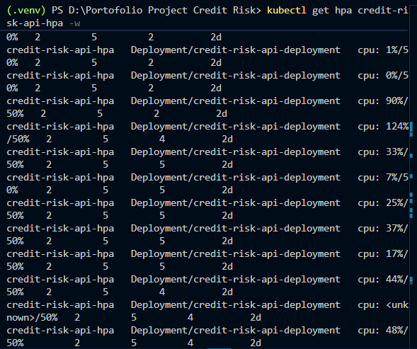
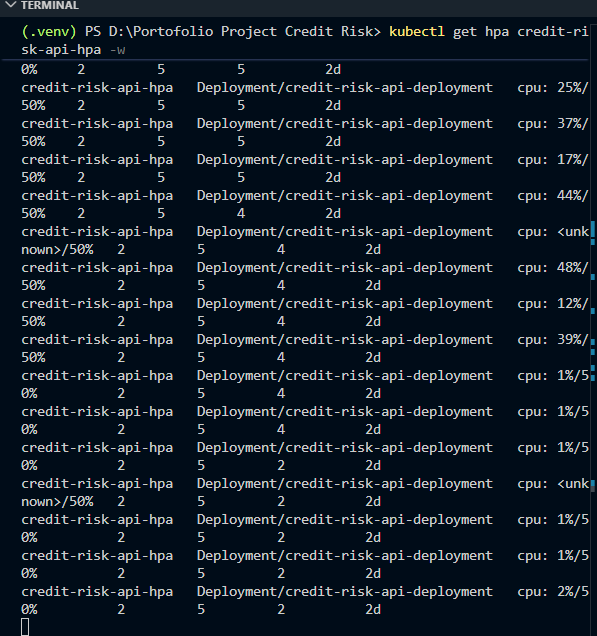

# 🏦 Credit Risk Scoring API (End-to-End ML & MLOps Infrastructure)

A production-ready Credit Risk Scoring system built to predict default probabilities on credit applications using XGBoost, served via FastAPI, monitored with Prometheus & Grafana, and auto-scaled using Kubernetes Horizontal Pod Autoscaler (HPA).

---

## 📌 Business Problem & Threshold Decision

In credit risk evaluation, asymmetric loss costs apply:
* **False Positive (Type I Error):** Rejecting a good borrower (loss of interest income — low impact).
* **False Negative (Type II Error):** Granting credit to a default-prone borrower (loss of principal capital — severe impact/NPL).

To minimize Non-Performing Loans (NPL), the decision threshold is set to **`0.35`** (instead of the default `0.50`). This decision prioritizes **Recall (0.72)** over Precision to catch high-risk applicants early before credit approval.

---

## 🏗️ Architecture & Tech Stack

* **Machine Learning:** Python, XGBoost, Scikit-Learn, Pandas, NumPy.
* **Serving & Validation:** FastAPI, Pydantic v2 (`model_dump()`), Uvicorn.
* **Infrastructure & Orchestration:** Docker Desktop, Kubernetes (Deployment, NodePort Service, HPA, Metrics Server).
* **Observability & Monitoring:** Prometheus, Grafana, `prometheus-fastapi-instrumentator`.

---

## 📊 Model Performance Summary

Evaluated on GiveMeSomeCredit dataset (~150k records, 6.68% default rate imbalanced class):

| Model Strategy | ROC-AUC | Default Recall | Note |
| :--- | :---: | :---: | :--- |
| Baseline Logistic Regression | 0.713 | 0.04 | Failed to capture default risk |
| LR (Balanced Class Weight) | 0.800 | 0.67 | Improved sensitivity |
| **XGBoost (`scale_pos_weight`)** | **0.854** | **0.72** | **Selected Production Model** |

> **Data Leakage Note:** Data preprocessing follows strict pipeline isolation where median imputation parameters are fitted strictly on the Training set (`X_train`) post-split to prevent subtle data leakage into the Test set.

---

## ⚡ Kubernetes Infrastructure & HPA Benchmark

The API is deployed with a minimum of 2 replicas and auto-scales up to 5 replicas based on a 50% CPU utilization threshold.



*Figure 1: HPA scale-out evidence reaching 5 replicas under 124% CPU load.*



*Figure 2: HPA scale-in evidence returning to 2 replicas during idle state.*

### 📈 Real-Time Auto-Scaling Evidence

Under simulated stress testing, the Horizontal Pod Autoscaler successfully scaled out the deployment to handle load spikes and scaled in during idle periods:

* **Scale-Out (Peak Load):** CPU utilization reached **>100%**, triggering HPA to expand replicas from **2 to 5 pods** (`maxReplicas`).
* **Scale-In (Cooldown):** CPU utilization dropped back to **~1%**, safely scaling replicas down from **5 back to 2 pods**.

```text
NAME                  REFERENCE                                TARGETS         MINPODS   MAXPODS   REPLICAS
credit-risk-api-hpa   Deployment/credit-risk-api-deployment   cpu: 124%/50%   2         5         5   <-- Scale-Out
credit-risk-api-hpa   Deployment/credit-risk-api-deployment   cpu: 1%/50%     2         5         2   <-- Scale-In
```

### 🛠️ Local Environment Constraints

For local evaluation using Docker Desktop / Minikube:

* `imagePullPolicy: Never`: Configured to utilize local Docker image builds directly without pushing to a remote container registry.
* `--kubelet-insecure-tls`: Applied to metrics-server to bypass local self-signed TLS certificate checks.
* **Grafana Dashboard:** Configured for ephemeral local testing (in-memory datasource).

---

## 🚀 How to Run Locally

### 1. Run via Docker Compose

```bash
docker-compose up --build -d
```

* API Docs: http://localhost:8000/docs
* Prometheus: http://localhost:9090
* Grafana: http://localhost:3000

### 2. Deploy to Kubernetes

```bash
# Apply manifests
kubectl apply -f k8s-deployment.yaml -f k8s-service.yaml -f k8s-hpa.yaml

# Check HPA status
kubectl get hpa credit-risk-api-hpa -w
```

---

## 📬 API Endpoint Contract

### `POST /predict`

**Request Payload**

```json
{
  "RevolvingUtilizationOfUnsecuredLines": 0.5,
  "age": 45,
  "NumberOfTime30-59DaysPastDueNotWorse": 0,
  "DebtRatio": 0.3,
  "MonthlyIncome": 5000,
  "NumberOfOpenCreditLinesAndLoans": 5,
  "NumberOfTimes90DaysLate": 0,
  "NumberRealEstateLoansOrLines": 1,
  "NumberOfTime60-89DaysPastDueNotWorse": 0,
  "NumberOfDependents": 1
}
```

**Response Output**

```json
{
  "default_probability": 0.1245,
  "threshold_used": 0.35,
  "decision": "APPROVED"
}
```